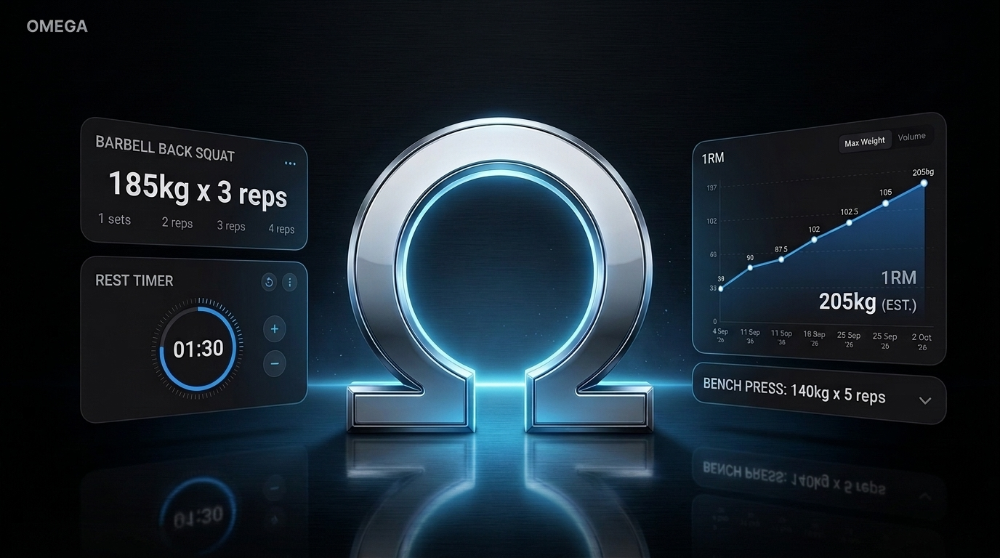
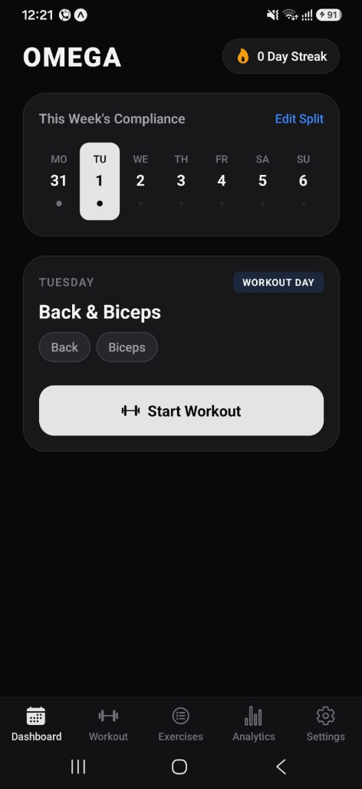
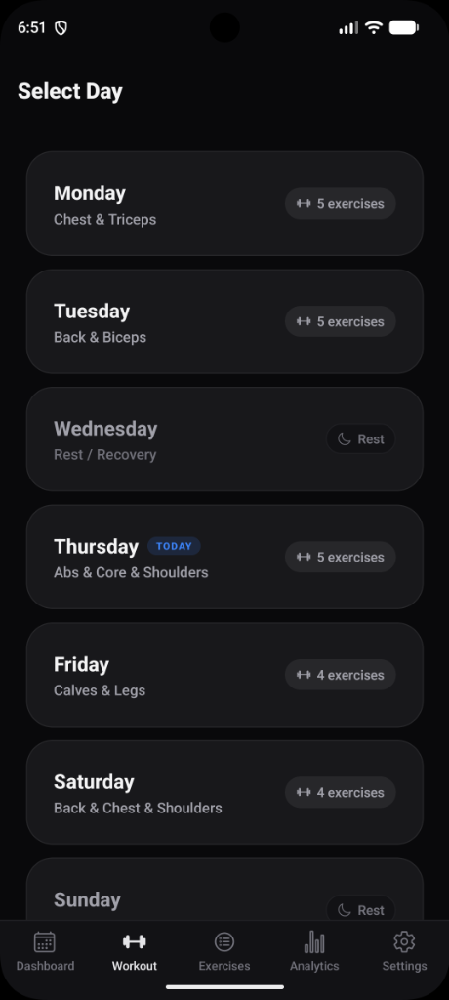
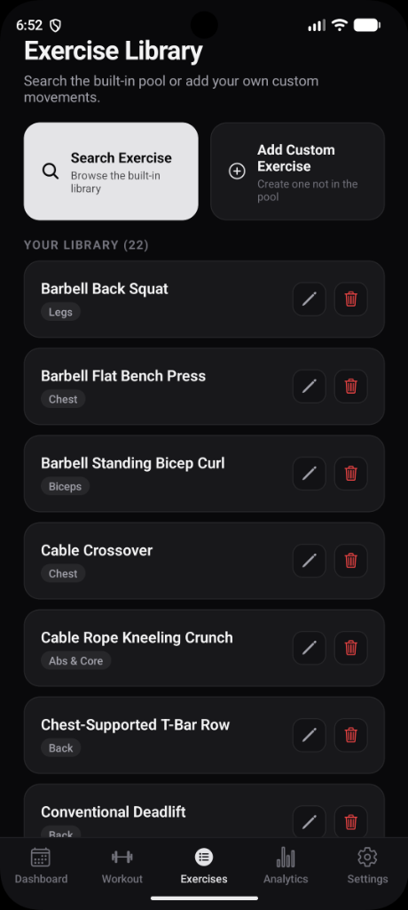
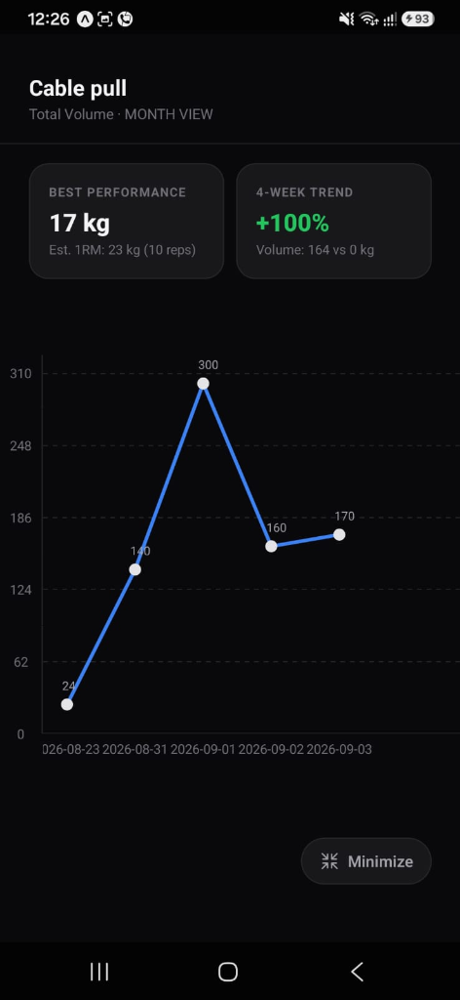
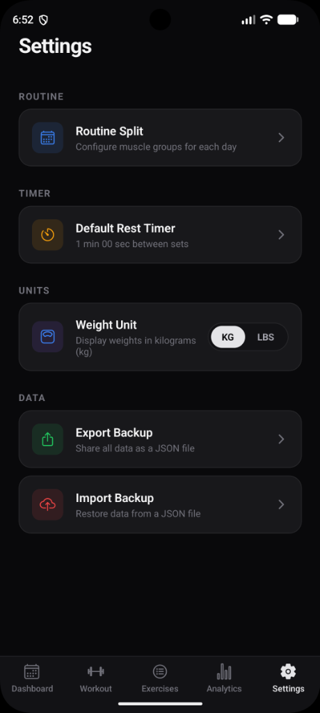
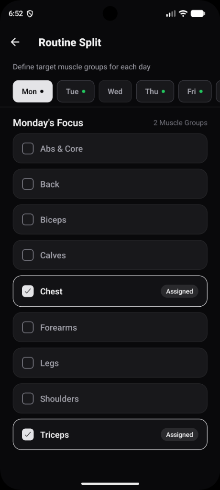
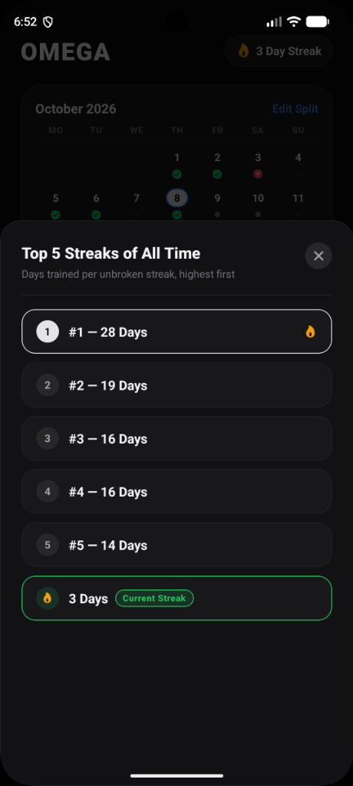

<div align="center">
  
</div>

<div align="center">
  <br />
  
  <h1>OMEGA</h1>
  <p><strong>Local-First Progressive Overload Engineering for Android</strong></p>
  <p>Zero cloud dependencies. Zero telemetry. 100% on-device embedded relational storage.</p>

  <p>
    <a href="https://omega-tracker.vercel.app"></a>
    <a href="https://github.com/ASSAS-Labs/Omega/actions/workflows/ci.yml"></a>
    <a href="https://github.com/ASSAS-Labs/Omega/actions/workflows/build-apk.yml"></a>
    
    
    <a href="LICENSE"></a>
  </p>

  <p>
    <a href="https://omega-tracker.vercel.app"><strong>Explore Product Website</strong></a> &nbsp;&bull;&nbsp;
    <a href="https://github.com/ASSAS-Labs/Omega/releases"><strong>Download Latest APK</strong></a> &nbsp;&bull;&nbsp;
    <a href="#system-architecture"><strong>System Architecture</strong></a> &nbsp;&bull;&nbsp;
    <a href="#quality-assurance--testing"><strong>Test Engineering</strong></a> &nbsp;&bull;&nbsp;
    <a href="#quickstart"><strong>Quickstart</strong></a>
  </p>
</div>

---

## Executive Summary

Most fitness applications treat strength training data as leverage: forced account creation, mandatory subscriptions for progression metrics, server round-trips in basement gyms with zero signal, and continuous telemetry pipelines tracking your routine.

**OMEGA** is engineered as an offline-first antidote. It runs entirely on-device, storing training history inside an embedded SQLite relational database configured with Write-Ahead Logging (WAL). There are no cloud servers, no account logins, no network pings, and no analytics SDKs.

From high-frequency set logging and real-time benchmark lookups to Epley one-rep max (1RM) curve calculation and split compliance tracking, every computation executes on the client thread with sub-millisecond latency.

---

## Product Showcase

### Live Web Experience

Visit the interactive web presentation at [omega-tracker.vercel.app](https://omega-tracker.vercel.app) to explore the 3D liquid chrome interactive emblem, dynamic compliance calendar matrix, and live 1RM progression curve visualization.

### Mobile Application Screens

<div align="center">
  
  &nbsp;
  
  &nbsp;
  
  &nbsp;
  
  &nbsp;
  
  &nbsp;
  
  &nbsp;
  
</div>

<br />

| Interface Module | Engineering Implementation | User & Product Impact |
|---|---|---|
| **Dashboard** | Monday-first calendar grid with multi-state day markers (Logged, Missed, Rest, Upcoming) and active streak indicator. | Instant visual feedback on training consistency; zero friction launch into today's planned session. |
| **Workout Logger** | Midpoint-hysteresis drag-to-reorder list, real-time benchmark querying, set completion status toggling. | Eliminates guesswork between sets by comparing current load against previous personal bests. |
| **Exercise Library** | FlashList 2.0 recycled cells partitioned by muscle group; supports runtime creation of custom exercises. | Sub-millisecond scroll frame rates with zero layout stutter, even over exhaustive movement pools. |
| **Progression Analytics** | Spline-rendered 1RM curves and volume bar trends with dynamic headroom calculation and date bucketing. | Objective proof of progressive overload; eliminates visual clipping on rapid strength spikes. |
| **Settings & Storage** | Instant KG/LBS dual-unit conversion with round-trip parity, configurable rest timer preferences, atomic JSON backup export. | True data sovereignty; one-tap complete database portability without vendor lock-in. |
| **Routine Split Setup** | Mon-Sun multi-group assignment matrix with badge feedback and automatic routine synchronization. | Adapts to any split discipline (PPL, Upper/Lower, Arnold, Bro split, or custom hybrid cycles). |
| **Streak History** | Top 5 all-time unbroken streak leaderboard driven by split-aware persistence algorithms. | Enforces scheduled rest discipline without breaking unbroken workout streaks. |

---

## Core Engineering Capabilities

### 1. Local-First Relational Data Engine
- **Engine**: SQLite via `expo-sqlite` (JSI bindings)
- **Concurrency & Integrity**: Journal mode configured to WAL (`PRAGMA journal_mode = WAL; PRAGMA foreign_keys = ON; PRAGMA busy_timeout = 5000;`).
- **Singleton Connection Pool**: A centralized connection manager eliminates thread race conditions and database locks across concurrent read operations.
- **Migration Pipeline**: Schema evolution is managed deterministically via `PRAGMA user_version`. Schema migrations are idempotent and transaction-isolated.

### 2. Zero-Loss Crash Recovery Lifecycle
- **Real-Time Draft Sync**: During active workout logging, state mutations are immediately debounced and written to an isolated local draft store.
- **Cold-Start Hydration**: If the operating system terminates the app process mid-workout (memory pressure, battery saver, or abrupt shutdown), OMEGA detects the draft on the subsequent boot cycle and renders an immediate recovery banner.
- **Atomic Commit Guarantee**: Completing a workout commits all logged sets, timestamps, and updated personal records within a single atomic database transaction before clearing the scratch draft.

### 3. Progression Analytics & Domain Mathematics
- **One-Rep Max (1RM) Formulation**: Computes peak estimated strength using the proven Epley formula:
  $$\text{1RM} = \text{Weight} \times \left(1 + \frac{\text{Reps}}{30}\right)$$
  Edge cases (e.g., zero reps, negative weights, non-numeric inputs) are caught by defensive math sanitizers with zero NaN leakage.
- **Dynamic Headroom Geometry**: Progression charts dynamically project an upper bound ceiling so that peak markers and numeric value labels never clip the viewport boundaries.
- **Multi-Granular Aggregation**: Logged data partitions across distinct time horizons: Session-by-Session, ISO-8601 Calendar Week, and Calendar Month.

### 4. Background Rest Timer with System Degradation
- **Cadence Engine**: Built on Notifee native Android channels. Rest countdowns continue accurately even when the app is backgrounded or the display is turned off.
- **Android 13+ Exact Alarm Handling**: Automatically probes exact-alarm permissions (`SCHEDULE_EXACT_ALARM`) and degrades to standard interval timers if permissions are restricted.
- **Haptic Alerts**: Native vibration pulses fire on countdown completion to prompt the lifter without requiring visual screen polling.

### 5. UI-Thread Animations & Recycled Rendering
- **Reanimated 4 Worklets**: Press feedback, sheet dismissals, and modal transitions execute directly on the UI thread, bypassing JavaScript bridge serialization overhead.
- **Zero Reflow Motion**: Animations are restricted exclusively to GPU-composited properties (`transform: scale`, `opacity`), eliminating layout reflows and battery drain.
- **FlashList 2.0 Virtualization**: Movement selection lists and routine catalogs employ structural recycling for minimal memory consumption.

---

## System Architecture

```text
+-----------------------------------------------------------------------------------+
|                                  OMEGA CLIENT                                     |
+-----------------------------------------------------------------------------------+
|  PRESENTATION LAYER (React Native 0.81 + React Navigation 7)                      |
|    - DashboardScreen      - ActiveWorkoutScreen      - AnalyticsScreen            |
|    - ExercisesScreen      - SplitSetupScreen         - SettingsScreen             |
|    - RestTimerModal       - StreakHistoryModal       - WorkoutDraftBanner         |
+-----------------------------------------------------------------------------------+
|  STATE & MOTION MANAGEMENT                                                        |
|    - Zustand UI Store (Active Session, Timer Cadence, Selected Split)             |
|    - Reanimated 4.1 UI-Thread Worklets (60 FPS Gestures & Press Feedback)         |
|    - FlashList 2.0 Virtual Cell Recycling                                         |
+-----------------------------------------------------------------------------------+
|  DOMAIN SERVICES & UTILITIES                                                      |
|    - Epley 1RM Engine     - Split-Aware Streaks      - Drag-Reorder Geometry      |
|    - WorkoutDraftService  - BackupSerializer         - NotifeeTimerService        |
+-----------------------------------------------------------------------------------+
|  PERSISTENCE LAYER (Embedded On-Device Relational SQLite)                         |
|    - PRAGMA journal_mode = WAL                       - PRAGMA foreign_keys = ON   |
|    - Idempotent Schema Migrations (user_version)     - Atomic Multi-Set Commits   |
|    - Zero Cloud Telemetry                            - Zero Outbound Network I/O  |
+-----------------------------------------------------------------------------------+
```

### Directory Structure

```text
Omega/
├── .github/workflows/         CI test pipeline and standalone APK compiler
├── assets/                    Application icon, screenshots, and hero banner
├── omega-site/                Production showcase landing page
├── src/
│   ├── components/            Reusable UI components (Modals, Banners, Feedback)
│   ├── constants/             Standard movement definitions and muscle categories
│   ├── hooks/                 Custom reactive hooks (useTimeSync, useWeightUnit)
│   ├── screens/               Top-level view controllers and screen modules
│   ├── services/              SQLite connection manager, drafts, timers, backup
│   ├── store/                 Zustand application state slices
│   ├── theme/                 Design tokens, obsidian color palettes, typography
│   ├── types/                 Strict TypeScript interfaces and schema contracts
│   └── utils/                 Domain mathematics, date bucketing, drag geometry
└── __mocks__/                 Jest test harness with real Node SQLite engine
```

---

## Tech Stack & Tooling

| Domain | Technology | Technical Rationale |
|---|---|---|
| **Mobile Runtime** | React Native 0.81 / Expo SDK 54 | Modern mobile runtime with native JSI integration. |
| **Language** | TypeScript 5.9 (Strict) | Exhaustive static typing with zero implicit `any`. |
| **Relational Database** | `expo-sqlite` 16.0 | Direct C-level SQLite bindings for low-overhead on-device relational storage. |
| **State Architecture** | Zustand 5.0 | Lightweight, boilerplate-free state containers with decoupled subscribers. |
| **Navigation** | React Navigation 7.x | Native stack routing combined with fluid bottom tab navigation. |
| **Charting Engine** | `react-native-gifted-charts` 1.4 | Dynamic SVG-backed line and bar charts with custom axis interpolation. |
| **System Alarms** | Notifee 9.1 | High-priority Android notification channels and background countdown timers. |
| **Motion & Physics** | Reanimated 4.1 | UI-thread worklet execution preventing JavaScript thread bottlenecks. |
| **List Virtualization** | Shopify FlashList 2.0 | Memory-efficient cell recycling for intensive exercise catalogs. |
| **Testing Harness** | Jest 30 / `jest-expo` 57 | Automated suite using Node's native SQLite engine (`node:sqlite`). |
| **CI / Automation** | GitHub Actions | Automated type-checking, test runs, and headless Gradle APK compilation. |

---

## Quality Assurance & Testing

Every code change must pass three automated quality gates before integration:

1. **Strict Type-Checking**: `npx tsc --noEmit` completes with zero diagnostics or errors.
2. **Real-Engine Relational Testing**: Service-layer tests run against Node 22's native SQLite engine (`node:sqlite`). Foreign keys, cascading deletes, index scans, and rollback semantics are tested against a real relational database rather than synthetic mocks.
3. **Comprehensive Test Coverage**: 290 automated tests across 16 test suites covering edge cases, math calculations, and UI interactions.

### Test Verification Matrix

```text
Test Suites: 16 passed, 16 total
Tests:       290 passed, 290 total
Snapshots:   0 total
Time:        ~6.4s
```

| Verification Category | Test Suite Scope | Test Assertions |
|---|---|---|
| **Domain Mathematics** | `calculations.test.ts` | 1RM Epley calculation accuracy, zero-rep safety, NaN fallbacks, KG/LBS conversion parity. |
| **Analytics Bucketing** | `analyticsCalculations.test.ts` | Session, weekly, and monthly data aggregation, chart headroom boundaries, empty data fallbacks. |
| **Split-Aware Streaks** | `dateUtils.test.ts` | Streak increments, rest-day tolerance (no penalty), missed-session resets, deduplication. |
| **Drag Geometry** | `dragReorder.test.ts` | Midpoint item swapping, boundary hysteresis calculations, stable reordering. |
| **Database Migrations** | `database.test.ts` | Idempotent migrations, foreign-key cascade enforcement, transaction rollback on failure. |
| **Crash Recovery Drafts** | `workoutDraftService.test.ts` | Mid-workout draft persistence, cold hydration, atomic draft purge on successful session save. |
| **Backup Portability** | `backupService.test.ts` | JSON schema validation, malformed payload rejection, atomic restore rollback. |
| **Background Timers** | `notifeeTimerService.test.ts` | Notification channel creation, background timestamp math, exact-alarm permission degradation. |
| **UI Integration** | `DashboardScreen.test.tsx`, `AnalyticsScreen.test.tsx`, etc. | Screen rendering, state bindings, user interaction handling, modal lifecycle checks. |

---

## Automated CI/CD & Build Pipeline

### 1. Continuous Integration (`ci.yml`)
Triggers on all pushes and pull requests targeting `main`.

```text
GitHub Push / Pull Request
       |
       +--> Node.js 24 Environment Setup
       +--> npm ci --legacy-peer-deps
       +--> npx tsc --noEmit (Strict TypeScript Compilation)
       +--> npm test -- --ci --watchAll=false (290 node:sqlite Tests)
       |
       +--> Status: GREEN (Merge Allowed)
```

### 2. Standalone Android APK Pipeline (`build-apk.yml`)
Bypasses commercial EAS cloud queues by compiling standalone APK binaries directly on GitHub Actions Linux runners:

```text
Release Tag (v*) or Manual Workflow Dispatch
       |
       +--> Java 17 (Temurin) & Node.js 22 Runtime Setup
       +--> Dependency Installation & Full Quality Gate Execution
       +--> Expo Prebuild: npx expo prebuild --platform android --clean
       +--> Headless Gradle Build: ./gradlew assembleRelease --no-daemon
       +--> Artifact Upload: omega-arm64-release-apk (~19.6 MB)
       +--> Publish GitHub Release with Release Notes
```

---

## Binary Size & Runtime Optimization

The release APK is engineered for minimal storage footprint and maximum runtime efficiency:

- **ABI Filtering**: Compiles exclusively for `arm64-v8a` architectures, eliminating legacy 32-bit overhead.
- **R8 Minification**: Performs proactive tree-shaking and dead code elimination (`enableMinifyInReleaseBuilds`).
- **Resource Shrinking**: Strips unused drawables, styles, and asset metadata (`enableShrinkResourcesInReleaseBuilds`).
- **ProGuard JSI Preservation**: Explicit keep rules ensure SQLite JSI bindings and Reanimated worklets are never mangled.
- **Debug Symbol Stripping**: Custom Expo config plugin strips unneeded `.so` symbol tables, reducing final bundle size to under 20 MB.

---

## Quickstart

### Prerequisites
- Node.js 22.13 or newer (required for `node:sqlite` service testing)
- npm 9 or newer
- Expo Go application, an Android Emulator, or a connected physical Android device

### Installation & Local Development

```bash
# 1. Clone repository
git clone https://github.com/ASSAS-Labs/Omega.git
cd Omega

# 2. Install dependencies
npm install

# 3. Start Expo development bundler
npm run start
```

Press `a` in the terminal to launch on a running Android emulator or physical device via USB debugging.

### Executing Quality Gates

```bash
# Static type validation
npx tsc --noEmit

# Execute full automated test suite with coverage
npm test -- --coverage
```

### Compiling Standalone Release APK Locally

```bash
# Clean prebuild generation
npx expo prebuild --platform android --clean

# Assemble release APK via Gradle
cd android
./gradlew assembleRelease --no-daemon
```

The compiled release binary will be available at:
`android/app/build/outputs/apk/release/app-release.apk`

---

## License

This software is released under the **PolyForm Noncommercial License 1.0.0**.

You are free to inspect the source code, fork the repository, and modify the application for personal and non-commercial educational use. Commercial distribution, monetization, and proprietary redistribution are strictly prohibited. Refer to the [LICENSE](LICENSE) file for complete legal terms.
